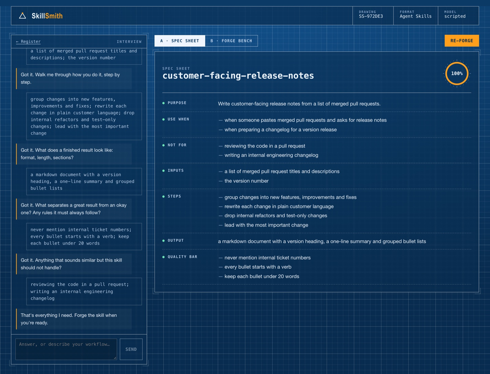
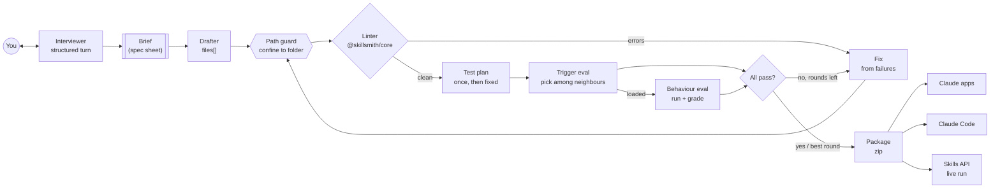

# SkillSmith

**Turn know-how into agent skills.**

<!-- The film: drag docs/skillsmith-promo.mp4 onto the line below in the GitHub editor. -->


Describe a workflow you know well. SkillSmith interviews you until it understands the job, then:
- drafts an [Agent Skill](https://platform.claude.com/docs/en/agents-and-tools/agent-skills/overview): a `SKILL.md` plus reference files
- lints it against the format
- tests it against realistic requests *and* near-misses that should not trigger it
- fixes what fails, round after round, until it passes
- hands you a bundle ready for the Claude apps, Claude Code or the Claude API


https://github.com/user-attachments/assets/62da9f9b-9c7e-40e2-8dce-717e41011043


## What it shows

| | |
|---|---|
| **Interviewer agent** | One question at a time. Each turn returns a structured update to a shared brief, and the UI renders it live as a spec sheet you can edit |
| **Draft → lint → test → fix loop** | A bounded loop. Each round is linted, tested against one fixed plan (so a fix can't game new tests), and revised from the concrete failures. The best round ships |
| **Trigger evals** | The real question for a skill is whether Claude picks it. Each test shows a picker only names and descriptions, the new skill among realistic neighbours, exactly as Claude sees them before loading |
| **Behaviour evals** | Triggering cases run with the skill loaded and are graded expectation by expectation, with evidence |
| **One linter, two runtimes** | The Agent Skills linter (name and description rules, reserved words, XML, body length, broken links, orphaned files, path escapes, size) lives in a shared TypeScript package. The server and the browser both run it, so edits lint live |
| **Real deployment path** | Download a zip laid out for every surface, or, with live runs on, upload it through the Skills API and run a prompt with it mounted in a code-execution container |
| **TypeScript end to end** | A pnpm monorepo: `core` (Zod schemas, linter, packager), `server` (Hono + Anthropic SDK), `web` (React). Zod schemas define the API, the model's structured outputs and the UI types |



## Architecture



The Lab products each use a different orchestration:

| Product | Orchestration |
|---|---|
| [Ashariri](https://github.com/balajisriraj/ashariri) | A routed state machine |
| [PaperSensei](https://github.com/balajisriraj/paper-sensei) | A parallel map-reduce |
| [VibeLens](https://github.com/balajisriraj/vibelens) | A tool-using agent |
| SkillSmith | An evaluator-optimizer loop: generate, measure against a fixed test set, revise from the failures, keep the best |

More in [docs/architecture.md](docs/architecture.md).

## Run it

```bash
pnpm install

# No API key: a deterministic scripted model
SKILLSMITH_LLM=scripted SKILLSMITH_SCRIPTED_DELAY=25 pnpm --filter @skillsmith/server start   # API on :8000
pnpm --filter @skillsmith/web dev                                                             # UI on :5173

# With Claude
export ANTHROPIC_API_KEY=sk-ant-...
pnpm --filter @skillsmith/server start
```

**Docker:** `cp .env.example .env && docker compose up --build`, then open http://localhost:8080.

## Tests and evals

```bash
pnpm typecheck && pnpm test   # core linter + packager, server (interview, forge loop, path guard, round limit), web state
pnpm eval                     # forges three worked interviews end to end
```

```
PASS  Release notes from merged PRs      rounds 75% → 100%   triggers 2/2   near-misses rejected 2/2   lint clean
PASS  Blameless incident postmortems     rounds 75% → 100%   triggers 2/2   near-misses rejected 2/2   lint clean
PASS  Weekly sales summary               rounds 75% → 100%   triggers 2/2   near-misses rejected 2/2   lint clean
```

Under the scripted model, a first draft's description covers only the first trigger. Testing catches the phrasings it misses, and the fix round widens the description, which is the failure the loop exists to catch. The server tests also run hostile drafters: one tries to write `../../etc/evil.sh`, which is dropped, and one never produces a SKILL.md, so the loop stops at the round limit and refuses to package.

## Layout

```
packages/core/   schemas.ts (Zod) · lint.ts · frontmatter.ts · bundle.ts (zip, completeness)
apps/server/     forge.ts (the loop and prompts) · llm.ts (Claude) · scripted.ts · live.ts (Skills API) · server.ts (Hono + SSE)
apps/web/        SpecSheet · ForgeBench (schematic, test matrix, bundle editor with live lint, export)
```

## The film

The promo is made in code, not screen-recorded. `promo/capture.mjs` runs the real app on the scripted model, interviews it, forges the skill and breaks a lint rule the way a user would, and saves DOM snapshots of each moment. `promo/kit/render.mjs` replays those snapshots as live HTML with a moving camera, captions and kinetic type, renders it frame by frame and adds an original score synthesised in Python (`promo/kit/score.py`).

```bash
cd promo && pnpm install --ignore-workspace
node capture.mjs        # snapshots of the real UI
node kit/render.mjs     # the film, in docs/
```

---

Part of [the Lab](https://balajisriraj.com/#lab), ten agentic products by [Balaji Sri Raj](https://balajisriraj.com).
