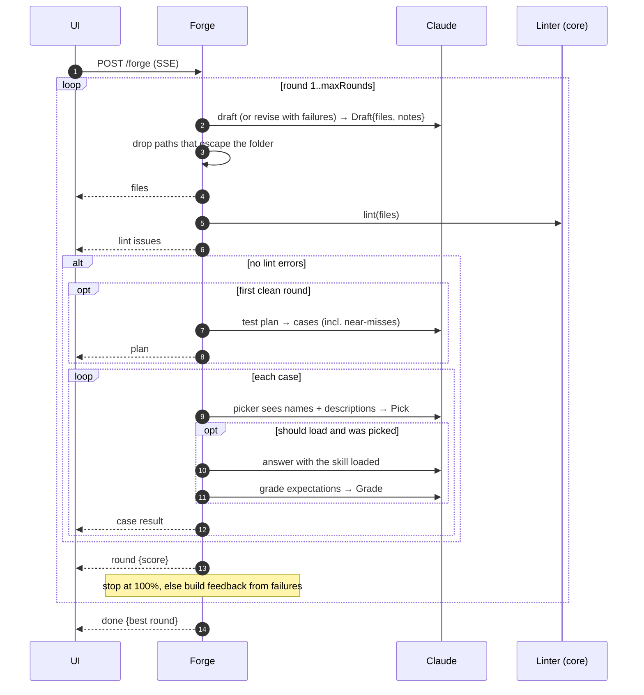

# Architecture

## The brief

The interview's only job is to fill a typed brief:

| Field | Purpose |
|---|---|
| purpose | What the skill is for |
| triggers | When to use it |
| not_for | Near-misses it shouldn't handle |
| inputs | What the user provides |
| steps | The workflow, in order |
| outputs | What a finished result looks like |
| quality_bar | Rules every result follows |
| examples | Worked examples |
| open_questions | What's still unclear |

Each user message produces one structured `InterviewTurn`: `{ reply, brief, ready }`. Claude returns the *whole* updated brief rather than a patch, so the state is always valid against the schema. The UI shows the brief as a spec sheet with a completeness gauge, and any field can be edited by hand (`PUT /api/sessions/:id/brief`).

## The forge loop

**Why the test plan is fixed.** It's generated once, from the first draft that lints clean, and reused for every later round. Regenerating it would let a revision drift toward easier tests, and scores across rounds wouldn't be comparable.

**Trigger evaluation.** Claude decides whether to load a skill from its `name` and `description` alone. The picker reproduces that moment: it sees the new skill among five realistic neighbours (PDF, spreadsheets, meeting minutes, code review, travel planning) and must name exactly one skill, or none. A trigger case passes if the skill is picked. A near-miss passes only if it isn't. Most real skill failures are description failures, and this is where they show.

**Behaviour evaluation.** For cases that should load and did, the request is answered with the skill's files in context, the way Claude reads them after loading. A judge grades each expectation with evidence.

**Feedback.** A revision gets the full current bundle plus a list of concrete failures, for example:
- `Not picked for "…" (picked meeting-minutes)`
- `Wrongly picked for "…"`
- `expected "every bullet starts with a verb"` plus the judge's evidence

The round with the highest score is the one offered for download.

## Linter rules (`@skillsmith/core`)

| Rule | Check |
|---|---|
| `skill-md` | A `SKILL.md` exists at the root |
| `frontmatter` | YAML frontmatter is present and is a mapping |
| `name` | Required; ≤ 64 characters; `^[a-z0-9]+(-[a-z0-9]+)*$`; no `anthropic` or `claude`; no XML |
| `description` | Required; ≤ 1024 characters; no XML. Warnings if it doesn't say *when* to use it, isn't in the third person, or is very short |
| `body` | Not empty. Warning above 500 lines |
| `links` | Every relative link from SKILL.md resolves to a bundled file |
| `orphan` | Warning for files SKILL.md never references, because Claude will never read them |
| `path` / `size` | No absolute paths, `..` segments or duplicates; under 200 files and 30 MB |

## Claude usage

- Structured outputs throughout: `client.beta.messages.parse` with `zodOutputFormat(schema)`. The same Zod schemas type the API and the UI.
- The system prompts carry `cache_control`. A forge run makes many calls with the same drafter, picker and judge prompts.
- Effort is set per role: low for interview turns, test planning, picking and judging; medium for drafting.
- Server-side fallback (`fallbacks: "default"`) re-runs declined requests on the fallback model. A final refusal becomes a typed error the UI can show.
- **Live runs** (opt-in): `client.skills.create` uploads the zip. Then `beta.messages.create` runs with `container.skills: [{ type: "custom", skill_id, version: "latest" }]` and the code execution tool, and the skill is deleted afterwards.

## Storage

Sessions are JSON documents written atomically (temp file plus rename), one per session. IDs are validated against `^[a-f0-9]{12}$` before touching the filesystem.
